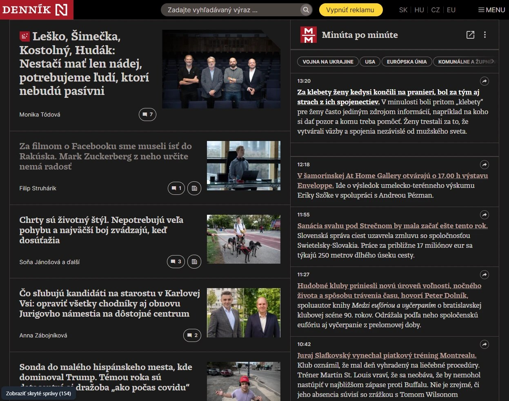
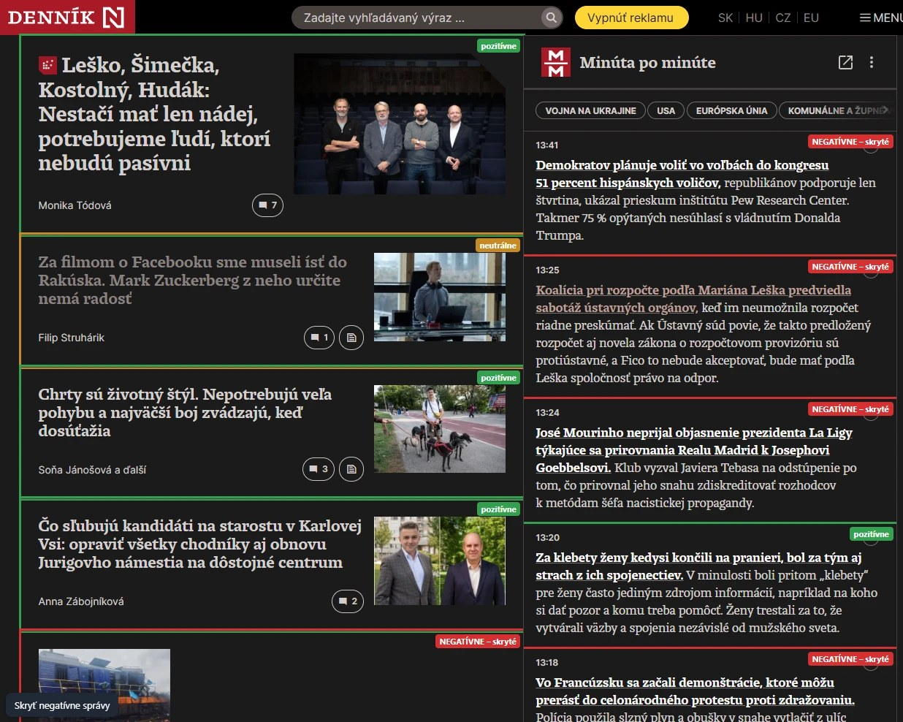
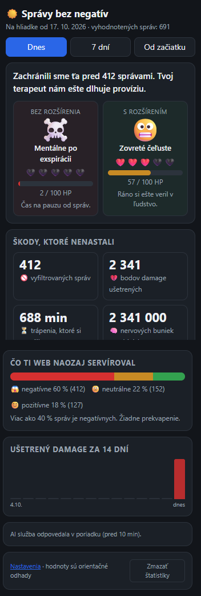

<p align="center"></p>

<h1 align="center">Správy bez negatív</h1>

<p align="center">Rozšírenie pre Chrome, Edge a Firefox, ktoré na spravodajskom webe skryje negatívne a psychicky zaťažujúce správy.</p>

<p align="center"><a href="https://mejmo.github.io/spravy-bez-negativ/"><strong>Webová stránka</strong></a></p>

<p align="center"></p>

## Stiahnutie

Balíky z [najnovšieho vydania](https://github.com/mejmo/spravy-bez-negativ/releases/latest)
(všetky verzie: [releases](https://github.com/mejmo/spravy-bez-negativ/releases)):

| Prehliadač | Súbor |
|---|---|
| Chrome | [spravy-bez-negativ-chrome.zip](https://github.com/mejmo/spravy-bez-negativ/releases/latest/download/spravy-bez-negativ-chrome.zip) |
| Edge | [spravy-bez-negativ-edge.zip](https://github.com/mejmo/spravy-bez-negativ/releases/latest/download/spravy-bez-negativ-edge.zip) |
| Firefox | [spravy-bez-negativ-firefox.zip](https://github.com/mejmo/spravy-bez-negativ/releases/latest/download/spravy-bez-negativ-firefox.zip) |

Inštalácia (Chrome, Edge): rozbaliť ZIP, otvoriť `chrome://extensions` (v Edge `edge://extensions`),
zapnúť **Developer mode** a cez **Load unpacked** vybrať rozbalený priečinok.

Inštalácia (Firefox): otvoriť `about:debugging#/runtime/this-firefox`, **Load Temporary Add-on…** a vybrať
ZIP (alebo `manifest.json` z rozbaleného priečinka). Dočasné rozšírenie zmizne po reštarte Firefoxu;
trvalá inštalácia vyžaduje podpis cez addons.mozilla.org.

## Čo robí

- Nájde správy (dlaždice článkov aj príspevky „Minúta po minúte“, vrátane widgetu v shadow DOM),
  pošle ich titulky na vyhodnotenie a negatívne skryje.
- Tlačidlo „Zobraziť skryté správy“ ukáže pôvodný web s farebným označením hodnotenia.
- Skrýva reklamné bloky.
- Štatistiky (popup po kliku na ikonu): ušetrený „mentálny damage“, porovnanie s rozšírením a bez neho.

## Podporované weby

- dennikn.sk (vrátane poddomén `www.dennikn.sk` a `e.dennikn.sk`)
- cas.sk (vrátane `www.cas.sk`)

## Ukážky

### Porovnanie s pôvodným webom

Tlačidlo vľavo dole zobrazí pôvodný web a označí hodnotenie každej správy:
červená = negatívne (skryté), žltá = neutrálne, zelená = pozitívne.

<p align="center"></p>

### Štatistiky



## Vývoj

Jeden zdrojový kód pre Chrome, Edge aj Firefox (kód používa `browser`, ak existuje, inak `chrome`).

Každý podporovaný web má v `content.js` vlastný adaptér (`DENNIKN`, `CAS`): povie, ktoré prvky sú správy,
odkiaľ vziať ID a titulok, čo skryť ako reklamu. Nový web = nový adaptér, doména do `manifest.json`
(`content_scripts.matches` a `host_permissions`) a zmienka v README a na webe.

```
node scripts/check.mjs     # kontrola manifestu, súborov, syntaxe a tajomstiev
node scripts/build.mjs     # zostaví dist/ pre chrome, edge a firefox (bez závislostí)
```

Z priečinka `dist/chrome` (alebo `dist/edge`) sa dá rozšírenie načítať cez **Load unpacked**.
Priamo z koreňa repozitára sa načíta Chromium verzia manifestu.

### Vydanie novej verzie

1. Zvýšiť `version` v `manifest.json` a commitnúť.
2. `git tag vX.Y.Z && git push origin vX.Y.Z`.
3. GitHub Actions (`.github/workflows/release.yml`) skontroluje, že tag zodpovedá verzii, zostaví balíky,
   zvaliduje Firefox balík a vytvorí release s tromi ZIP-mi.

Každý push na `main` a každý pull request prejde kontrolou a zostavením (`.github/workflows/ci.yml`).

## Súbory

| Súbor | Účel |
|---|---|
| `manifest.json` | oprávnenia a registrácia skriptov (Chromium; pre Firefox ho upraví build) |
| `icons/` | ikony rozšírenia (16, 32, 48, 128 px) a zdroj `icon.svg` |
| `background.js` | klient AI proxy (installId, dávky, validácia odpovede) |
| `content.js` | hľadanie správ, skrývanie, indikátor načítania, tlačidlo |
| `stats.html` / `stats.js` | popup so štatistikami |
| `options.html` / `options.js` | nastavenia |
| `scripts/` | kontrola (`check.mjs`) a build pre všetky prehliadače (`build.mjs`) |
| `.github/workflows/` | CI a automatické vydanie |
| `docs/` | webová stránka (GitHub Pages) a zásady ochrany súkromia (`privacy.html`) |
| `store/` | podklady pre Chrome Web Store: texty, screenshoty, dlaždica |

## Dáta

Na proxy sa posielajú len titulky (alebo úvodné vety krátkych príspevkov), ich ID (číslo, alebo kód odvodený z adresy
článku, napr. `cas.sk:nazov-clanku`), doména zdroja a anonymné ID inštalácie.
Hodnotenia a štatistiky sa ukladajú lokálne v `chrome.storage.local`.
